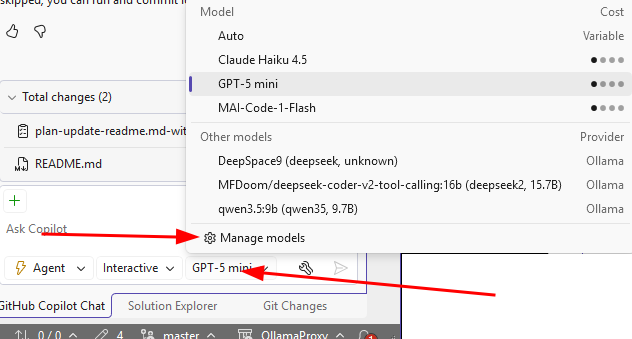
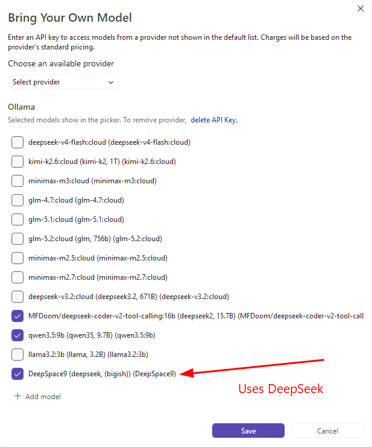

# TLinkProxy Proxy

TLinkProxy is a lightweight .NET 10 Razor Pages application that acts as a forwarding proxy for an Ollama-compatible model server.

The proxy forwards API requests under `/v1/*` and `/api/*` to a configured remote Ollama endpoint.

The project includes a GitHub-style context optimizer that tries to reduce request payload size before forwarding.

Session activity and request/response snippets are logged via a session logger.

Token usage before and after optimization is recorded daily under a `tokendata` folder.

Default runtime URL is configured in `Program.cs` to listen on `http://localhost:11434`.

## Required environment variables:

- `REMOTE_OLLAMA_URL` — the base URL of the remote Ollama server (required).
- `REMOTE_OLLAMA_DEFAULT_MODEL` — default model name used if none supplied (optional).
- `DEEPSEEK_API_KEY` — API key for DeepSeek if using the `DeepSpace9` mapping (optional).

## Runtime notes:

- The app is configured to run as a Windows Service when deployed and logs to the Windows Event Log.
- The app creates a `logs` directory for per-session logs and a `tokendata` directory for token statistics under the app base folder.
- In development the HTTP client handler accepts any server certificate for forwarded requests; review `HomeController` before production use.

## Key files and responsibilities:

- `Program.cs` — host setup, Razor Pages, routing, and service registrations.
- `Controllers/HomeController.cs` — core proxy logic, request interception, and streaming handling.
- `Services/ContextOptimizer.cs` — payload optimization for large GitHub-like contexts.
- `Services/ProxySessionLogger.cs` — console and optional file logging for proxy sessions.
- `Services/DailyTokenStore.cs` — persistent token usage tracking.

## Quick run instructions:

1. Open the solution `TLinkProxy.slnx` in Visual Studio 2022/2026 or use the .NET CLI in the project folder.
2. Set required environment variables (`REMOTE_OLLAMA_URL`, optionally `REMOTE_OLLAMA_DEFAULT_MODEL` and `DEEPSEEK_API_KEY`).
3. Run the app using Visual Studio or `dotnet run --project TLinkProxy`.
4. Send API requests to the proxy (e.g. `curl -X POST http://localhost:11434/v1/tags`).

## Security and disclaimers:

- The proxy forwards Authorization headers when provided; ensure you trust the remote endpoint configuration.
- Review the `HttpClientHandler` settings in `HomeController` (server certificate validation) before using in production.

## Visual Studio Integration

Integration with Visual Studio is available for GitHub Copilot which allows you to have Ollama installed on a remote computer, this then acts as a proxy to the remote Ollama installation.  

